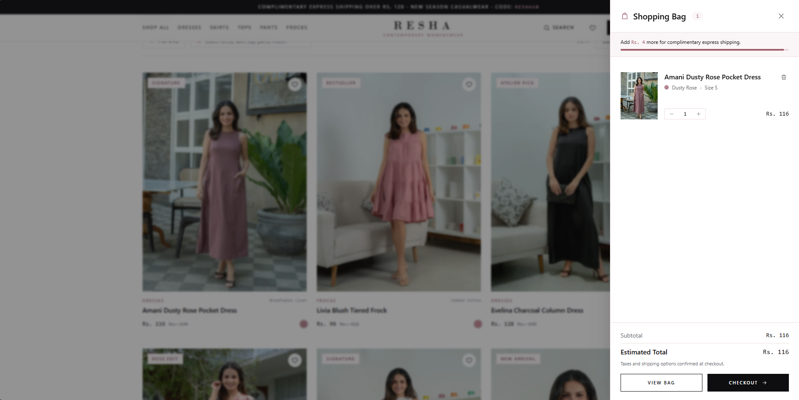
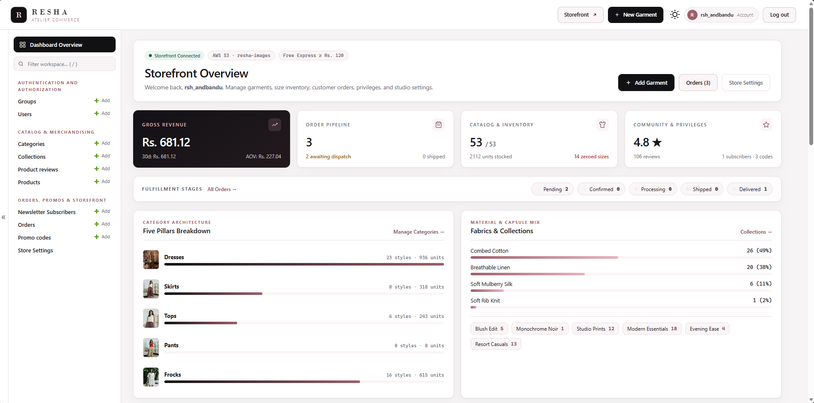

# Resha — Full-Stack E-Commerce Platform


**Resha** is a production-deployed, full-stack e-commerce storefront and order management platform. Built from the ground up with **Next.js**, **Django REST Framework**, and **PostgreSQL**, the application is containerized with **Docker** and deployed on **AWS Lightsail** behind an **Nginx** reverse proxy with automated **GitHub Actions** CI/CD.

---

## System Architecture

```text
                        ┌─────────────────────────────────────────┐
                        │        AWS Lightsail (Ubuntu VPS)       │
                        │                                         │
┌──────────────┐  HTTP  │  ┌───────────────────────────────────┐  │
│              ├───────►│  │      Nginx Reverse Proxy (:80)    │  │
│   Customer   │        │  └────────┬─────────────────┬────────┘  │
│   Browser    │        │           │ /               │ /api/     │
└──────────────┘        │           ▼                 │ /admin/   │
                        │  ┌─────────────────┐        │ /static/  │
                        │  │   Next.js App   │        ▼           │
                        │  │  (:3000 SSR/UI) ├───────►┌─────────┐ │
                        │  └─────────────────┘  JSON  │ Django  │ │
                        │                      (Internal) + DRF   │ │
                        │                             │ (:8000) │ │
                        │                             └─┬────┬──┘ │
                        │                               │    │    │
                        │            ┌──────────────────┘    │    │
                        │            ▼                       │    │
                        │  ┌──────────────────┐              │    │
                        │  │  PostgreSQL 16   │              │    │
                        │  │  (Docker Volume) │              │    │
                        │  └──────────────────┘              │    │
                        └────────────────────────────────────┼────┘
                                                             │
                                                             ▼
                                                    ┌─────────────────┐
                                                    │     AWS S3      │
                                                    │ (Product Media) │
                                                    └─────────────────┘
```
---
## Screenshots

### Storefront & Checkout



### Django Admin Panel

---

## Key Engineering & Security Highlights

* **Tamper-Proof Server-Side Checkout:** Frontend payloads transmit only product identifiers and quantities. All unit prices, order totals (`Decimal`), and stock deductions are calculated and validated exclusively on the backend inside atomic database transactions (`transaction.atomic` + `select_for_update`).
* **Hybrid Server/Client Data Layer:** Next.js Server Components communicate directly with the Django API over Docker's internal network (`INTERNAL_API_URL`) with ISR revalidation, while client interactions route cleanly through Nginx.
* **Containerized Multi-Service Orchestration:** Runs isolated `frontend`, `backend`, and `db` services via Docker Compose, utilizing PostgreSQL health checks (`pg_isready`) and binding container ports strictly to `127.0.0.1` so all external traffic passes through Nginx.
* **Cloud Media Storage (AWS S3):** Product imagery is served via AWS S3 backed by a dedicated, least-privilege IAM user policy.
* **Automated CI/CD Pipeline:** Pushing to `main` triggers a GitHub Actions workflow that connects via SSH, pulls verified changes, rebuilds Docker images, and prunes dangling layers automatically.

---

## Tech Stack

| Layer | Technologies |
| :--- | :--- |
| **Frontend** | Next.js (App Router, Standalone Build), React, TypeScript, Tailwind CSS |
| **Backend** | Python, Django 5.2, Django REST Framework, Gunicorn |
| **Database** | PostgreSQL 16 |
| **Infrastructure** | Docker, Docker Compose, Nginx, Ubuntu Linux (AWS Lightsail) |
| **Cloud & CI/CD** | AWS S3, AWS IAM, GitHub Actions |

---

## Project Structure

```text
resha/
├── .github/
│   └── workflows/
│       └── deploy.yml          # Automated SSH deployment pipeline
├── backend/
│   ├── config/                 # Django settings, root URLs, WSGI config
│   ├── products/               # Product catalog models, serializers, API views
│   ├── orders/                 # Checkout validation, atomic order processing
│   ├── Dockerfile              # Production Gunicorn container build
│   └── requirements.txt
├── frontend/
│   ├── app/                    # Next.js App Router pages & layouts
│   ├── components/             # Reusable UI, layout, product, and cart components
│   ├── lib/                    # Centralized fetch wrapper & formatting utilities
│   ├── services/               # Typed API service modules
│   ├── types/                  # TypeScript interfaces
│   └── Dockerfile              # Multi-stage Next.js standalone build
├── docker-compose.yml          # Multi-container orchestration & health checks
├── .env.example                # Environment variable template
└── README.md
```

---

## Local Development Setup

### Prerequisites
* Docker & Docker Compose
* Git

### 1. Clone the Repository
```bash
git clone https://github.com/andbandu/resha.git
cd resha
```

### 2. Configure Environment Variables
Copy the example environment file and fill in your local values:
```bash
cp .env.example .env
```

Example `.env` structure:
```env
# Django
DJANGO_SECRET_KEY=your-local-secret-key
DJANGO_DEBUG=True
DJANGO_ALLOWED_HOSTS=localhost,127.0.0.1
FRONTEND_URL=http://localhost:3000

# PostgreSQL
POSTGRES_DB=resha_db
POSTGRES_USER=resha_user
POSTGRES_PASSWORD=your-local-db-password
POSTGRES_HOST=db
POSTGRES_PORT=5432

# Next.js
NEXT_PUBLIC_API_URL=http://127.0.0.1:8000/api
INTERNAL_API_URL=http://backend:8000/api
NEXT_PUBLIC_S3_BASE_URL=https://your-bucket.s3.amazonaws.com

# AWS S3
AWS_ACCESS_KEY_ID=your-access-key
AWS_SECRET_ACCESS_KEY=your-secret-key
AWS_STORAGE_BUCKET_NAME=your-bucket-name
AWS_S3_REGION_NAME=ap-southeast-1
```

### 3. Build and Start Containers
```bash
docker compose up -d --build
```

### 4. Run Migrations & Create an Admin Account
```bash
docker compose exec backend python manage.py migrate
docker compose exec backend python manage.py createsuperuser
```

* **Storefront:** `http://localhost:3000`
* **Django Admin:** `http://localhost:8000/admin/`

---

## Production Deployment

In production on **AWS Lightsail**, **Nginx** acts as the public-facing reverse proxy on ports `80`/`443`:
* `/api/`, `/admin/`, and `/static/` proxy to the Django/Gunicorn container (`127.0.0.1:8000`).
* `/` proxies to the Next.js standalone server (`127.0.0.1:3000`).

Every push to `main` automatically deploys via `.github/workflows/deploy.yml`.

---

## Roadmap

* [ ] Custom domain configuration with Let's Encrypt SSL/HTTPS
* [ ] Payment gateway integration
* [ ] Instant admin order notifications (Telegram Bot / Email webhooks)
* [ ] Customer order tracking portal


## 2. AWS S3 Image Storage Setup

* **Bucket:** `resha-images`
* **Region:** `ap-southeast-2` (Sydney)
* **Public Access:** Uncheck **Block all public access**, then apply the bucket policy below.
* **File Naming Rule:** Use lowercase and hyphens for new uploads (e.g., `amani-dress-1.webp` instead of `AMANI DRESS image 1.webp`) for clean URLs and better SEO.

### S3 Bucket Policy (Permissions → Bucket policy)

```json
{
  "Version": "2012-10-17",
  "Statement": [
    {
      "Sid": "PublicReadGetObject",
      "Effect": "Allow",
      "Principal": "*",
      "Action": "s3:GetObject",
      "Resource": "arn:aws:s3:::resha-images/*"
    }
  ]
}
```

### Bulk Upload Local Images via AWS CLI (Optional)

```bash
aws s3 sync ./public/images s3://resha-images/images
```

### Bulk Fix `.webp` Content-Type (Run in AWS CloudShell in `ap-southeast-2`)
Run this if newly uploaded `.webp` files download instead of displaying in the browser:

```bash
aws s3 cp s3://resha-images/ s3://resha-images/ \
  --recursive \
  --exclude "*" \
  --include "*.webp" \
  --metadata-directive REPLACE \
  --content-type "image/webp" \
  --cache-control "public, max-age=31536000"
```

---

## 3. Next.js Frontend Configuration

### Local Environment File (`frontend/.env.local`)
Not committed to Git. Create manually in `frontend/` for local development:

```env
NEXT_PUBLIC_S3_BASE_URL=[https://resha-images.s3.ap-southeast-2.amazonaws.com](https://resha-images.s3.ap-southeast-2.amazonaws.com)
```

### Next.js Config (`frontend/next.config.ts`)

```ts
import type { NextConfig } from "next";

const nextConfig: NextConfig = {
  output: "standalone",
  images: {
    // Uncomment "inline" if you want "Open image in new tab" to view instead of download
    // contentDispositionType: "inline",
    remotePatterns: [
      {
        protocol: "https",
        hostname: "resha-images.s3.ap-southeast-2.amazonaws.com",
        port: "",
        pathname: "/**",
      },
    ],
    // Allows S3 images on local IPv6/NAT64 mobile hotspots without weakening production SSRF protection
    dangerouslyAllowLocalIP: process.env.NODE_ENV === "development",
  },
};

export default nextConfig;
```

### Rendering S3 Images in Components

```tsx
import Image from "next/image";

const S3_URL = process.env.NEXT_PUBLIC_S3_BASE_URL;

export default function ProductImage() {
  return (
    <Image alt="Amani Dress" height="{1000}" src="{`${S3_URL}/amani-dress-1.webp`}" width="{800}"/>
  );
}
```

### Root Layout Scroll Behavior Fix (`frontend/app/layout.tsx`)
Prevents Next.js smooth-scroll console warnings during route transitions:

```tsx
export default function RootLayout({
  children,
}: {
  children: React.ReactNode;
}) {
  return (
    <html lang="en" data-scroll-behavior="smooth">
      <body>{children}</body>
    </html>
  );
}
```

### Run Locally

```bash
cd frontend
npm install
npm run dev
```

---

## 4. Docker Configuration

### Frontend Dockerfile (`frontend/Dockerfile`)
*Note: Ensure `frontend/public/` exists in Git (keep at least one file such as `favicon.ico` or `.gitkeep`), otherwise the `COPY public` line will fail.*

```dockerfile
FROM node:22-alpine AS builder
WORKDIR /app
COPY package*.json ./
RUN npm ci
COPY . .
ARG NEXT_PUBLIC_S3_BASE_URL
ENV NEXT_PUBLIC_S3_BASE_URL=$NEXT_PUBLIC_S3_BASE_URL
RUN npm run build

FROM node:22-alpine AS runner
WORKDIR /app
ENV NODE_ENV=production
COPY --from=builder /app/public ./public
COPY --from=builder /app/.next/standalone ./
COPY --from=builder /app/.next/static ./.next/static
EXPOSE 3000
CMD ["node", "server.js"]
```

### Docker Ignore (`frontend/.dockerignore`)

```text
node_modules
.next
.env.local
.git
```

### Docker Compose (`docker-compose.yml` in repo root `resha/`)

```yaml
services:
  frontend:
    build:
      context: ./frontend
      args:
        NEXT_PUBLIC_S3_BASE_URL: ${NEXT_PUBLIC_S3_BASE_URL}
    ports:
      - "127.0.0.1:3000:3000"
    restart: always
    env_file:
      - .env
```

---

## 5. AWS Lightsail Server Setup (From Scratch)

* **OS:** Ubuntu 24.04 LTS
* **Plan:** $12/month (2 GB RAM, 60 GB SSD) in `ap-southeast-2`
* **Networking:** Attach a **Static IP** and open IPv4 Firewall ports `22` (SSH), `80` (HTTP), and `443` (HTTPS).
* **SSH Key:** Download the default `.pem` key from Lightsail **Account → SSH keys**.

### Step A: Install Docker, Nginx, Certbot & 2 GB Swap Memory

```bash
sudo apt update && sudo apt upgrade -y
sudo apt install -y nginx certbot python3-certbot-nginx git

# Install Docker
curl -fsSL [https://get.docker.com](https://get.docker.com) | sudo sh
sudo usermod -aG docker $USER

# Create 2 GB Swap (prevents out-of-memory crashes during Next.js builds)
sudo fallocate -l 2G /swapfile
sudo chmod 600 /swapfile
sudo mkswap /swapfile
sudo swapon /swapfile
echo '/swapfile none swap sw 0 0' | sudo tee -a /etc/fstab
```

*(Close and reopen the SSH terminal after running this so `docker` works without `sudo`.)*

### Step B: Clone Repo, Create Production `.env`, and Start Container

```bash
git clone [https://github.com/YOUR_USERNAME/YOUR_REPO.git](https://github.com/YOUR_USERNAME/YOUR_REPO.git) ~/my-store
cd ~/my-store

# Create production .env in the SAME folder as docker-compose.yml
nano .env
```

Paste into `.env` (save with `Ctrl + O`, `Enter`, `Ctrl + X`):

```env
NEXT_PUBLIC_S3_BASE_URL=[https://resha-images.s3.ap-southeast-2.amazonaws.com](https://resha-images.s3.ap-southeast-2.amazonaws.com)
```

Build and start:

```bash
docker compose up -d --build
```

### Step C: Nginx Reverse Proxy (Without Domain — Static IP Only)

Create `/etc/nginx/sites-available/my-store`:

```bash
sudo nano /etc/nginx/sites-available/my-store
```

```nginx
server {
    listen 80 default_server;
    server_name _;

    location / {
        proxy_pass [http://127.0.0.1:3000](http://127.0.0.1:3000);
        proxy_http_version 1.1;
        proxy_set_header Upgrade $http_upgrade;
        proxy_set_header Connection 'upgrade';
        proxy_set_header Host $host;
        proxy_set_header X-Real-IP $remote_addr;
        proxy_set_header X-Forwarded-For $proxy_add_x_forwarded_for;
        proxy_set_header X-Forwarded-Proto $scheme;
    }
}
```

Enable the site, remove the default Nginx page, and reload:

```bash
sudo rm -f /etc/nginx/sites-enabled/default
sudo ln -sf /etc/nginx/sites-available/my-store /etc/nginx/sites-enabled/
sudo nginx -t && sudo systemctl reload nginx
```

Verify at `http://YOUR_LIGHTSAIL_STATIC_IP`.

---

## 6. GitHub Actions CI/CD Setup

### Required Repository Secrets
Go to **GitHub Repo → Settings → Secrets and variables → Actions → New repository secret**:

| Secret Name | Value |
|---|---|
| `LIGHTSAIL_HOST` | Lightsail Static IPv4 address |
| `LIGHTSAIL_USER` | `ubuntu` |
| `LIGHTSAIL_SSH_KEY` | Full contents of the Lightsail `.pem` private key |

### Workflow File (`.github/workflows/deploy.yml` in repo root `resha/`)
*Make sure `main` (or `master`) and `~/my-store` (or `~/resha`) match your actual branch and server folder.*

```yaml
name: Deploy Frontend to Lightsail

on:
  push:
    branches: [ "main" ]
    paths-ignore:
      - "**.md"

jobs:
  deploy:
    runs-on: ubuntu-latest
    steps:
      - name: Deploy via SSH
        uses: appleboy/ssh-action@v1.2.0
        with:
          host: ${{ secrets.LIGHTSAIL_HOST }}
          username: ${{ secrets.LIGHTSAIL_USER }}
          key: ${{ secrets.LIGHTSAIL_SSH_KEY }}
          script: |
            cd ~/my-store
            git pull origin main
            docker compose up -d --build
            docker image prune -f
```

### Golden Rule for Editing Files
* **Edit locally in VS Code and push to GitHub:** `docker-compose.yml`, `Dockerfile`, `.github/workflows/deploy.yml`, and all source code.
* **Edit directly on Lightsail with `nano`:** Only untracked server files (`.env` and `/etc/nginx/sites-available/my-store`).

---

## 7. Daily Server Commands & Troubleshooting Cheat Sheet

### Lightsail Operations (Run inside `~/my-store`)

```bash
# Check running containers
docker compose ps

# View live Next.js logs (Ctrl + C to exit)
docker compose logs -f frontend

# Manual rebuild and restart
docker compose up -d --build

# Clean up old Docker images/cache if disk space gets low
docker system prune -f

# Check RAM, swap, and disk space
free -h
df -h

# Test and reload Nginx after config edits
sudo nginx -t && sudo systemctl reload nginx
```

### Fix `git pull` Conflict on Server
If a Git-tracked file (like `docker-compose.yml`) was accidentally edited with `nano` on Lightsail:

```bash
git checkout -- .
git pull
```

### Fix Embedded Git Repo Warning (Local)
If adding a new framework subfolder triggers `warning: adding embedded git repository`:

```bash
git rm --cached frontend
rm -rf frontend/.git
git add .
git commit -m "Add frontend project"
```

---

## 8. Future Upgrades

### A. Add Custom Domain + Free HTTPS (SSL)
1. Point DNS **A Records** (`@` and `www`) to your Lightsail Static IP.
2. Update `/etc/nginx/sites-available/my-store` to replace `server_name _;` with:
   ```nginx
   server_name yourstore.com [www.yourstore.com](https://www.yourstore.com);
   ```
3. Reload Nginx and issue SSL certificate:
   ```bash
   sudo nginx -t && sudo systemctl reload nginx
   sudo certbot --nginx -d yourstore.com -d [www.yourstore.com](https://www.yourstore.com)
   ```

### B. Add Django Backend + PostgreSQL Later

1. Add `backend` and `db` services to `docker-compose.yml`:
   ```yaml
   services:
     frontend:
       build:
         context: ./frontend
         args:
           NEXT_PUBLIC_S3_BASE_URL: ${NEXT_PUBLIC_S3_BASE_URL}
       ports:
         - "127.0.0.1:3000:3000"
       restart: always
       env_file:
         - .env

     backend:
       build: ./backend
       command: gunicorn config.wsgi:application --bind 0.0.0.0:8000
       ports:
         - "127.0.0.1:8000:8000"
       depends_on:
         - db
       restart: always
       env_file:
         - .env

     db:
       image: postgres:16-alpine
       volumes:
         - postgres_data:/var/lib/postgresql/data
       environment:
         POSTGRES_DB: ${POSTGRES_DB}
         POSTGRES_USER: ${POSTGRES_USER}
         POSTGRES_PASSWORD: ${POSTGRES_PASSWORD}
       restart: always

   volumes:
     postgres_data:
   ```
2. Add `/api/` and `/admin/` blocks inside `/etc/nginx/sites-available/my-store`:
   ```nginx
   location /api/ {
       proxy_pass [http://127.0.0.1:8000](http://127.0.0.1:8000);
       proxy_set_header Host $host;
       proxy_set_header X-Real-IP $remote_addr;
       proxy_set_header X-Forwarded-For $proxy_add_x_forwarded_for;
       proxy_set_header X-Forwarded-Proto $scheme;
   }

   location /admin/ {
       proxy_pass [http://127.0.0.1:8000](http://127.0.0.1:8000);
       proxy_set_header Host $host;
       proxy_set_header X-Real-IP $remote_addr;
       proxy_set_header X-Forwarded-For $proxy_add_x_forwarded_for;
       proxy_set_header X-Forwarded-Proto $scheme;
   }
   ```
3. Connect Django media uploads to `resha-images` S3 bucket via `django-storages` and `boto3`.

### C. Scaling & Billing Notes
* **CloudFront CDN:** When traffic grows, place AWS CloudFront in front of `resha-images` (1 TB/month free transfer, private S3 bucket via OAC, and clean `https://cdn.yourstore.com/...` URLs).
* **Lightsail Billing:** Stopping an instance does **not** stop billing—delete unused instances (take a snapshot first if you want a backup).
* **AWS Free Plan:** Upgrade to the Paid Plan before your 6-month Free Plan window expires so the live store stays online.